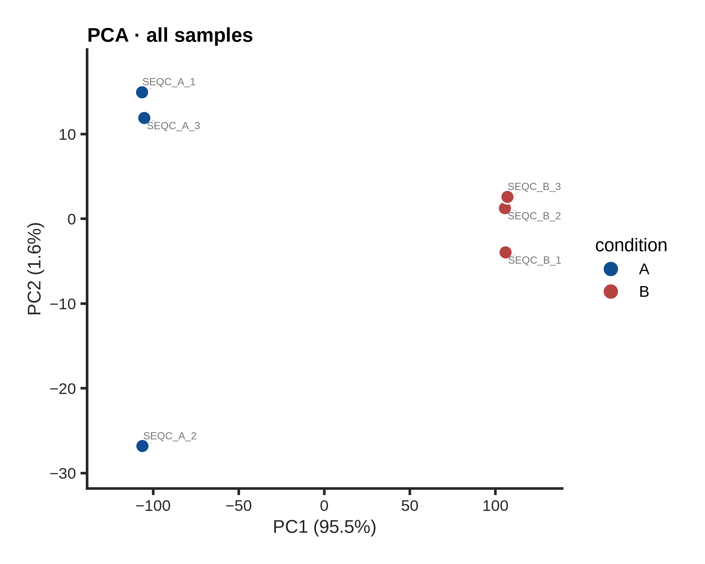
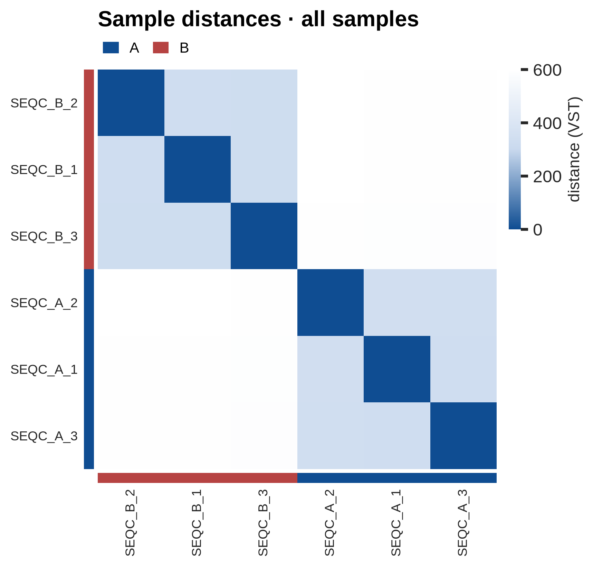
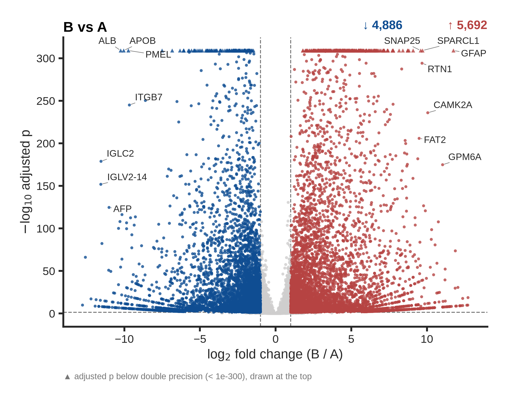
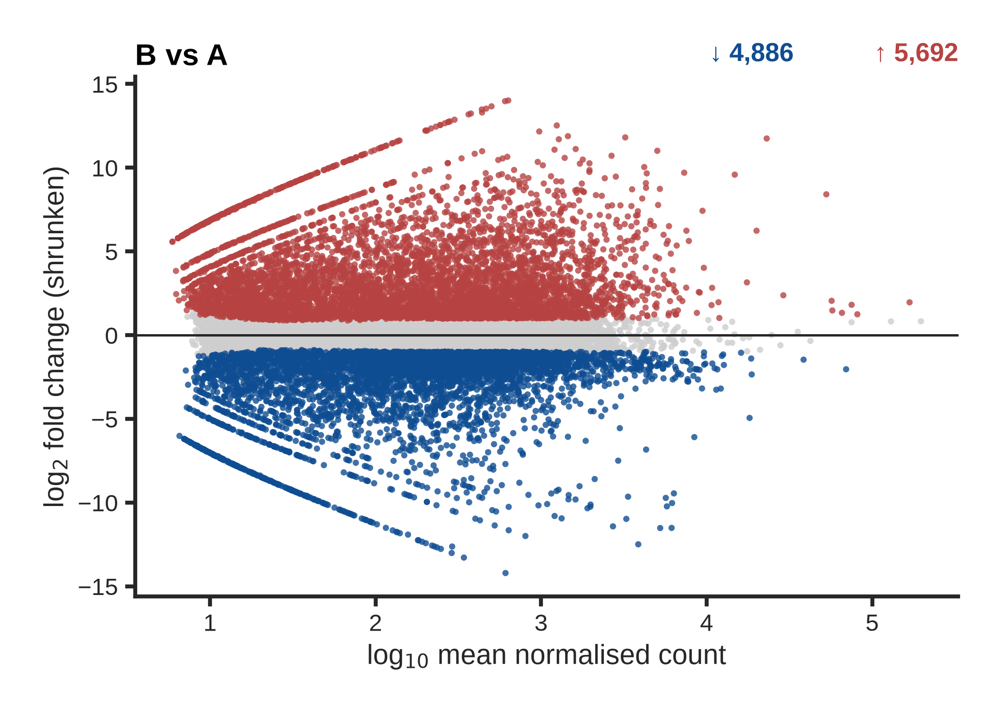
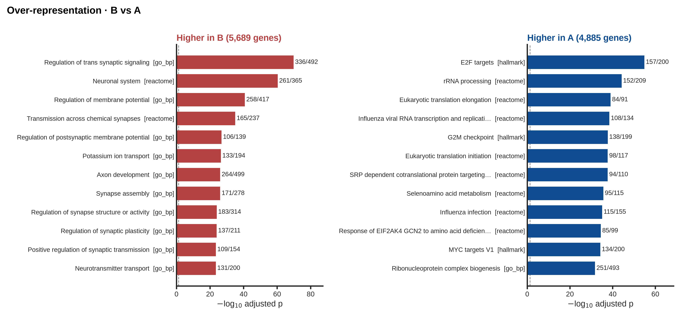
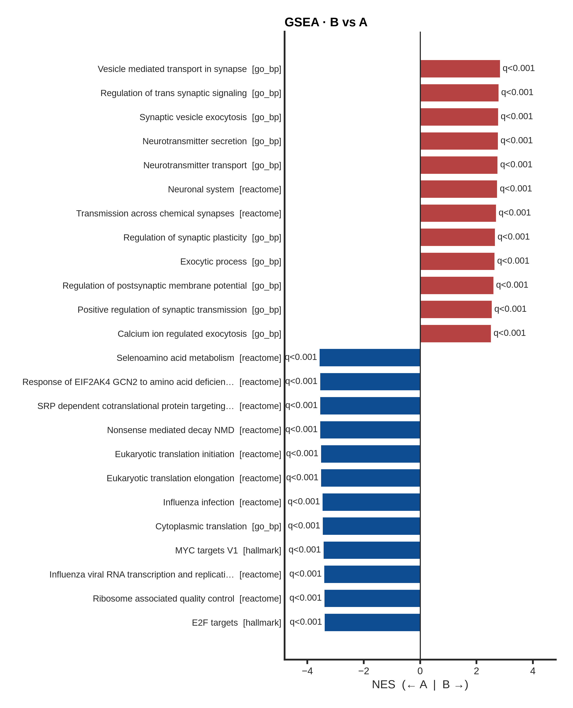
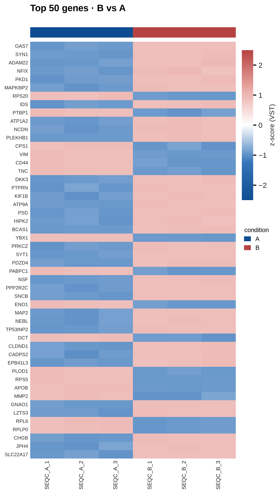
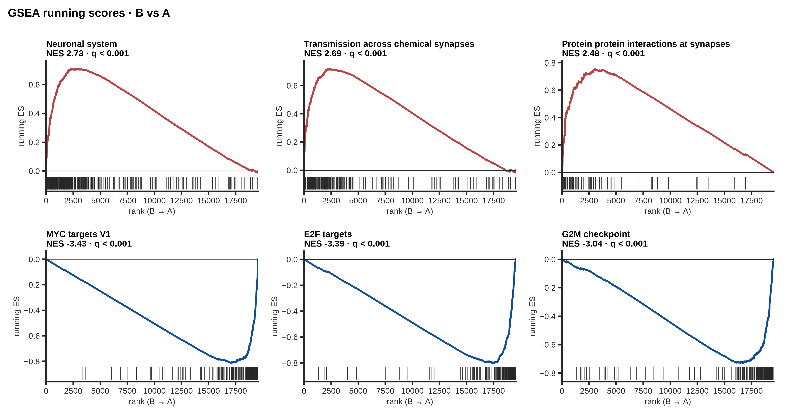

# Example outputs

Real artefacts from a real run, committed so the repository shows what sm-core/rnaseq
produces without anyone having to run it first. Everything under `seqc/` comes from the
human tutorial ([tests/tutorial/seqc](../tests/tutorial/seqc/README.md)), run on
2026-10-21: SEQC/MAQC-III, three UHRR (A) and three brain (B) libraries, GENCODE 50 +
ERCC92, both branches.

Count matrices are **excerpts**: the header plus 20 informative genes and four spike-ins.
The point is the shape of the output, not the full 79,033-gene matrices.

| File | From | What it is |
|---|---|---|
| `gene_counts.star.excerpt.tsv` | `results/counts/star/gene_counts.tsv` | STAR branch: integer counts |
| `gene_counts.salmon.excerpt.tsv` | `results/counts/salmon/gene_counts.tsv` | Salmon branch: estimated counts |
| `gene_tpm.salmon.excerpt.tsv` | `results/counts/salmon/gene_tpm.tsv` | Salmon branch: TPM |
| `samples.salmon.tsv` | `results/counts/salmon/samples.tsv` | the `colData` every `.rds` carries |
| `strandedness.tsv` | `results/qc/strandedness.tsv` | declared vs. STAR- vs. Salmon-inferred |
| `star_gene_counts_summary.tsv` | `results/counts/star/gene_counts_summary.tsv` | what STAR counted and why the rest was not |
| `count_composition.{star,salmon}.tsv` | `results/qc/<branch>/biotypes_mqc.tsv` | % of counts by gene class |
| `multiqc_{star,salmon}.html` | `results/qc/<branch>/multiqc_report.html` | the two QC reports, complete — open in a browser |
| `validation.txt` | `tests/tutorial/seqc/validate.py` | both matrices, and the differential expression, against ERCC and TaqMan truth |
| `de/` | `results/de/salmon/` (`-w de`) | differential expression of brain (B) vs UHRR (A): the figures, and excerpts of the tables (see below) |

## What to look at

**`gene_counts.star.excerpt.tsv`**: the two reference RNAs are visible at a glance.

```
gene_name  SEQC_A_1  SEQC_A_2  SEQC_A_3  SEQC_B_1  SEQC_B_2  SEQC_B_3
GFAP             11         6        11     48993     47080     48238    astrocytes: brain only
SNAP25           46        30        46     29366     28851     32058    neurons
MKI67          3226      2757      3312         5         3         2    proliferation: cell lines only
KRT8          13120     10569     12282        21         7        15    epithelial cancer lines
POLR2A         2718      2222      2698      2817      2825      2799    flat: the TaqMan normaliser
```

UHRR is pooled from ten cancer cell lines, so it proliferates and is partly epithelial.
HBRR is adult brain. The matrix says so in five rows.

**The same genes in `gene_counts.salmon.excerpt.tsv`.** For most genes the two branches
give nearly the same numbers. Two rows show where they differ, and why there are two
branches:

```
                 SEQC_A_1 ... SEQC_B_3
RPS23   STAR       1242   ...    972
        Salmon     7642   ...   2726
NME2    STAR         50   ...     33
        Salmon     4115   ...    984
```

RPS23 has ten annotated pseudogenes (RPS23P*), and NME2 shares its exons with the
NME1-NME2 read-through gene. STAR discards every fragment that maps to more than one
locus, or to two genes at once. Salmon assigns those fragments by likelihood. Neither
gene is in the TaqMan set, so nothing here says which number is right for these two.
Genome-wide, though, Salmon's fold changes agree slightly better with qPCR (r = 0.968 vs
0.964, `validation.txt`).

**`strandedness.tsv`**: every library is **unstranded**, called independently by both
branches, with a forward share of 0.500. SEQC's Illumina sites used the non-stranded TruSeq
RNA kit. With `strandedness: auto` nothing had to be declared.

**`count_composition.salmon.tsv`**: brain carries twice UHRR's mitochondrial share (12% vs
6.5%). That's biology (neurons are mitochondria-rich), not a QC failure. rRNA is
essentially zero (poly-A selection), and the ERCC spike-ins are 1–1.6% of each library.

**`star_gene_counts_summary.tsv`**: about 13% of fragments are `N_ambiguous`, overlapping
two genes. That share is typical for an unstranded library, where genes on opposite
strands cannot be told apart. A stranded library would show far fewer.

**`validation.txt`**: the result that matters. ERCC ratio groups recovered within 0.1
log2 units in both branches (r = 0.992). TaqMan fold changes match at r = 0.964 (STAR) and
0.968 (Salmon) over 665 genes. The two branches agree with each other at r = 0.995.

## Differential expression (`-w de`)

The SEQC tutorial config defines one analysis, brain (B) against UHRR (A), three libraries
each. Everything in `de/` comes from the Salmon matrix; the STAR matrix gives the same
picture (`validation.txt`). These are the files every contrast produces, in the style
every sm-core figure shares: red for up, blue for down, grey for not significant.

| File | From (`results/de/salmon/seqc/all/…`) | What it is |
|---|---|---|
| `summary.png`, `summary.salmon.tsv` | `../../summary.*` | genes up and down per contrast, all analyses |
| `pca.png` | `pca.*` | PCA of the model's samples: check this first |
| `sample_distances.png` | `sample_distances.*` | distances between samples, clustered |
| `volcano.png`, `volcano.pdf` | `B_vs_A/volcano.*` | every PNG also comes as a PDF with editable text |
| `ma.png` | `B_vs_A/ma.*` | expression vs shrunken fold change |
| `heatmap.png` | `B_vs_A/heatmap.*` | the 50 most significant genes, every sample |
| `ora.png`, `ora_{up,down}.excerpt.tsv` | `B_vs_A/enrichment/ora*` | over-representation in the up and down lists (top 15 rows) |
| `gsea.png`, `gsea_curves.png`, `gsea.excerpt.tsv` | `B_vs_A/enrichment/gsea*` | preranked GSEA (top 15 rows) |
| `deseq2_results.excerpt.tsv` | `B_vs_A/deseq2_results.tsv` | the 25 most significant genes, all columns |
| `deseq2_results.selected_genes.tsv` | `B_vs_A/deseq2_results.tsv` | tissue markers and housekeeping genes |

**Start with the PCA.** Replicates sit together, and 95% of the variance separates the two
RNAs:

 

**The volcano names markers on each side.** For brain: GFAP (astrocytes), SNAP25 and
CAMK2A (neurons). For UHRR: ALB, APOB and AFP (UHRR includes a liver cancer line),
immunoglobulin light chains (a B-cell line), PMEL (a melanoma line). Genes whose adjusted
p is below double precision are drawn as triangles at the top.

 

**Enrichment tells the same story as the biology.** Up in brain: synaptic signalling and
the neuronal system. Up in UHRR, a pool of proliferating cancer cell lines: E2F and MYC
targets, the G2/M checkpoint, ribosome biogenesis. ORA tests the significant genes
against the genes that were tested; GSEA ranks all of them, so both directions show
in one chart.



 



**The numbers check out.** `validation.txt`: PyDESeq2's fold changes agree with TaqMan
qPCR at r = 0.96, and of the genes qPCR shows changing at least two-fold, 89–91% are
called significant, 99% in the qPCR's direction. In `deseq2_results.selected_genes.tsv`,
POLR2A, the MAQC TaqMan normaliser, is flat (log2FC 0.06, not significant), while
GFAP is about 3,500 times (2^11.8) higher in brain.

## What is not here

BAMs (11 GB), full matrices and per-sample tool outputs are not committed, nor the DE
tables beyond the excerpts. The tutorial
regenerates them in about 3.5 h, indices included.
